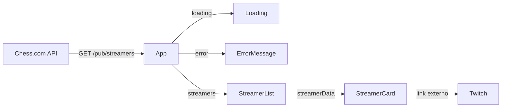

<div align="center">

# ♟️ ChessLive Hub

**Uma vitrine responsiva para descobrir criadores de xadrez e acompanhar quem está ao vivo.**

O ChessLive Hub consome a API pública do Chess.com, organiza os streamers em uma interface moderna e leva o usuário diretamente à transmissão na Twitch.

  <p>
    
    
    
    
    
  </p>

[Visão geral](#-visão-geral) •
[Arquitetura](#-arquitetura) •
[Como executar](#-como-executar) •
[Estrutura](#-estrutura-de-pastas) •
[Roadmap](#-roadmap)

</div>

---

## 🎯 Visão geral

O projeto resolve uma necessidade simples: reduzir a distância entre fãs de xadrez e criadores que estão transmitindo naquele momento. A aplicação consulta o diretório de streamers do Chess.com, representa cada item em um card reutilizável e destaca visualmente as transmissões ao vivo.

Além da entrega visual, o projeto demonstra fundamentos importantes de front-end:

- consumo assíncrono de API REST com Fetch API;
- modelagem de dados e props com TypeScript;
- composição e responsabilidade única de componentes React;
- gerenciamento explícito dos estados de carregamento, sucesso e erro;
- grid fluido, breakpoints responsivos e feedback de interação;
- acessibilidade básica, foco visível e respeito a movimento reduzido;
- build otimizado para produção com Vite.

## ✨ Funcionalidades

- listagem dinâmica de streamers cadastrados no Chess.com;
- avatar, nome de usuário e link direto para a Twitch;
- indicador **AO VIVO** exibido de forma condicional;
- abertura da transmissão em uma nova aba de maneira segura;
- layout adaptado para desktop, tablet e celular;
- estado de carregamento com animação;
- mensagem de erro para falhas de rede ou respostas inválidas;
- microinterações nos cards, links e elementos em foco.

## 🧰 Tecnologias

| Tecnologia                          | Papel no projeto                                                        |
| ----------------------------------- | ----------------------------------------------------------------------- |
| ⚛️ **React 19**                     | Componentização, renderização declarativa e ciclo de vida da interface  |
| 🔷 **TypeScript**                   | Tipagem do contrato da API, estado e propriedades dos componentes       |
| ⚡ **Vite 8**                       | Servidor de desenvolvimento, HMR e geração do bundle de produção        |
| 🎨 **CSS3**                         | Design system, Grid Layout, responsividade, animações e estados visuais |
| 🧹 **ESLint 10**                    | Padronização e análise estática do código                               |
| ♟️ **Chess.com Published Data API** | Origem pública dos dados dos streamers                                  |

O projeto não depende de bibliotecas de componentes ou de estado global. A interface e as interações foram construídas com React e CSS, mantendo o bundle e a arquitetura objetivos.

## 🏗️ Arquitetura

A aplicação segue um fluxo unidirecional simples. O componente `App` concentra a busca e os estados globais da tela; os componentes de apresentação recebem apenas os dados necessários por props.



### Responsabilidades dos módulos

- **`App.tsx`** — orquestra a requisição, mantém os estados da tela e decide qual interface renderizar.
- **`StreamerList.tsx`** — percorre a coleção recebida e garante uma `key` estável para cada card.
- **`StreamerCard.tsx`** — apresenta os dados individuais e renderiza o status ao vivo condicionalmente.
- **`Loading.tsx`** — fornece feedback enquanto a resposta da API não chega.
- **`Error.tsx`** — isola e apresenta falhas ao usuário.
- **`types.ts`** — centraliza o contrato que conecta a resposta externa aos componentes internos.
- **arquivos CSS** — separam estilos globais, layout da página, lista e card.

### Fluxo de estados

| Estado     | Condição                            | Resultado na interface               |
| ---------- | ----------------------------------- | ------------------------------------ |
| Carregando | requisição em andamento             | indicador animado de carregamento    |
| Sucesso    | resposta HTTP válida                | grid com os streamers retornados     |
| Erro       | falha de rede ou resposta não `2xx` | mensagem de erro legível             |
| Ao vivo    | `is_live === true`                  | selo vermelho no card correspondente |

## 🔌 Integração com a API

A fonte de dados é o endpoint público:

```http
GET https://api.chess.com/pub/streamers
```

Não são necessárias chave de API nem variáveis de ambiente. A resposta utilizada pela interface segue este contrato:

```ts
interface Streamer {
  username: string;
  avatar: string;
  twitch_url: string;
  is_live: boolean;
}

interface StreamersResponse {
  streamers: Streamer[];
}
```

O `response.ok` é verificado antes da conversão do JSON. Qualquer exceção é capturada e convertida em uma mensagem para a interface, enquanto o bloco `finally` encerra o estado de carregamento.

## 📱 Interface e experiência

O visual utiliza uma paleta escura com roxo como cor de ação e vermelho para transmissões ao vivo. Tokens CSS definidos em `:root` mantêm cores, superfícies, bordas e sombras consistentes.

### Comportamento responsivo

- **acima de 980 px:** três cards por linha;
- **entre 601 px e 980 px:** dois cards por linha;
- **até 600 px:** um card por linha;
- **até 380 px:** avatar e espaçamentos são reduzidos para telas estreitas.

Também foram incluídos foco visível para navegação por teclado, textos alternativos nas imagens, contraste entre superfícies e suporte a `prefers-reduced-motion`.

## 🚀 Como executar

### Pré-requisitos

- [Node.js](https://nodejs.org/) `20.19+` ou `22.12+`;
- npm (incluído na instalação do Node.js);
- acesso à internet para consultar a API do Chess.com.

### Instalação

Depois de clonar este repositório, acesse a pasta do projeto e instale as dependências:

```bash
cd chesslive-hub
npm ci
npm run dev
```

O Vite exibirá no terminal o endereço local da aplicação, normalmente `http://localhost:5173`.

### Build de produção

```bash
npm run build
npm run preview
```

Os arquivos otimizados são gerados em `dist/`.

## 📜 Scripts disponíveis

| Comando           | Descrição                                          |
| ----------------- | -------------------------------------------------- |
| `npm run dev`     | inicia o servidor local com Hot Module Replacement |
| `npm run build`   | gera a versão otimizada para produção              |
| `npm run preview` | serve localmente o conteúdo gerado em `dist/`      |
| `npm run lint`    | executa a análise estática configurada pelo ESLint |

## 📂 Estrutura de pastas

```text
chesslive-hub/
├── public/
│   ├── favicon.svg                 # favicon da aplicação
│   └── icons.svg                   # recurso vetorial público
├── src/
│   ├── components/
│   │   ├── error/
│   │   │   ├── Error.css           # estilo e animação do erro
│   │   │   └── Error.tsx           # estado de erro
│   │   ├── loading/
│   │   │   └── Loading.tsx         # estado de carregamento
│   │   ├── streamerCard/
│   │   │   ├── StreamerCard.tsx    # apresentação de um streamer
│   │   │   └── StreamerCard.css    # estilos e interações do card
│   │   └── streamerList/
│   │       ├── StreamerList.tsx    # composição da lista
│   │       └── StreamerList.css    # grid e breakpoints da lista
│   ├── App.tsx                     # busca de dados e estados da página
│   ├── App.css                     # layout e hero da aplicação
│   ├── index.css                   # estilos globais e design tokens
│   ├── main.tsx                    # bootstrap do React
│   ├── types.ts                    # contratos TypeScript
│   └── vite-env.d.ts               # tipos fornecidos pelo Vite
├── eslint.config.js                # regras de qualidade de código
├── index.html                      # documento HTML de entrada
├── package.json                    # dependências e scripts
├── tsconfig.json                   # configuração do TypeScript
└── vite.config.js                  # configuração do Vite
```

`node_modules/` e `dist/` não fazem parte da arquitetura-fonte: são, respectivamente, dependências instaladas e artefatos gerados pelo build.

---

<div align="center">
  Feito com ♟️, React e TypeScript.
</div>
